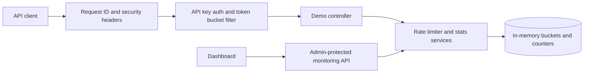
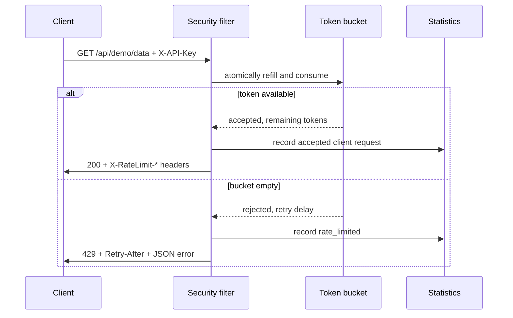

# Secure API Rate Limiter and Traffic Monitor

A small Java 25/Spring Boot application demonstrating API-key authentication, a concurrency-safe token bucket, bounded traffic statistics, and a local monitoring dashboard. It is an interview/learning project, not production security infrastructure.

## Features

- Per-client token buckets configured in `application.yml`; each check/refill/consume is atomic under a per-bucket lock.
- Monotonic elapsed-time accounting, fractional refill, `Retry-After`, and standard `X-RateLimit-*` headers.
- Separate demo API and admin keys, generic authentication failures, request IDs, and bounded time-series telemetry.
- Vanilla HTML/CSS/JavaScript dashboard with a Canvas chart and live request/burst controls.
- Unit and MockMvc integration tests use an injectable fake monotonic clock; no sleeps in the algorithm or tests.

## Architecture





## Token Bucket Example

The `demo-free` profile starts with 5 tokens and refills at 1 token/second. A burst of five accepted requests can spend the full bucket immediately. A sixth request is rejected with `Retry-After: 1`; after one elapsed second, one token is available again. Refill retains fractional tokens internally and caps at the configured capacity. `System.nanoTime()` is used for elapsed time so wall-clock corrections do not change refill behavior.

## Prerequisites and Commands

Java 25 is required. Maven is not required; the checked-in wrapper downloads Maven 3.9.11 on first use. Run these commands in PowerShell from the repository root:

```powershell
.\mvnw.cmd clean verify
.\mvnw.cmd package
.\mvnw.cmd spring-boot:run
```

Open `http://localhost:8080`. To run the packaged application instead:

```powershell
java -jar .\target\secure-api-rate-limiter-1.0.0.jar
```

The CI equivalent is `./mvnw -B verify` on Java 25. `target/` is ignored by Git.

## Endpoints

| Method and path | Access | Purpose |
| --- | --- | --- |
| `GET /api/demo/public` | Public | Unlimited, counted sample response. |
| `GET /api/demo/data` | `X-API-Key` | Rate-limited sample JSON and rate-limit headers. |
| `GET /api/monitoring/summary` | `X-Admin-Key` | Aggregate totals, uptime, and rejection reasons. |
| `GET /api/monitoring/clients` | `X-Admin-Key` | Per-client counts, last request, rejection rate, and available tokens. No keys are returned. |
| `GET /api/monitoring/timeseries` | `X-Admin-Key` | Sixty 5-second buckets (about five minutes). |
| `GET /actuator/health` | Public | Health status only. |

API errors use `{timestamp, status, error, message, path, requestId}`. Missing and invalid API/admin keys both return `401` with the same generic authentication message. Invalid API keys increment an aggregate counter; their supplied values are never retained in a client map.

### PowerShell Examples

All credentials below are explicitly fake local demo values. Replace them only in a local shell when testing overrides; never commit real credentials.

```powershell
$base = 'http://localhost:8080'
$apiKey = 'demo-key-free-123'
$adminKey = 'fake-admin-key-123'
Invoke-RestMethod "$base/actuator/health"
Invoke-RestMethod "$base/api/demo/public"
Invoke-RestMethod "$base/api/demo/data" -Headers @{ 'X-API-Key' = $apiKey }
Invoke-RestMethod "$base/api/monitoring/summary" -Headers @{ 'X-Admin-Key' = $adminKey }
```

An actual protected success captured from the running app:

```json
{"timestamp":"2026-10-12T12:39:31.864823800Z","clientId":"demo-free","remainingTokens":4,"samplePayload":{"recordId":"sample-001","message":"Protected sample data","classification":"demo"}}
```

An actual exhausted-bucket response captured from the running app:

```http
HTTP/1.1 429 Too Many Requests
Retry-After: 1
X-RateLimit-Limit: 5
X-RateLimit-Remaining: 0
X-RateLimit-Reset: 5
```

```json
{"timestamp":"2026-10-12T12:39:31.885881100Z","status":429,"error":"Too Many Requests","message":"Rate limit exceeded","path":"/api/demo/data","requestId":"e3b85c65-cc96-4734-96f8-65ae2ae20e5f"}
```

The captured reset value can vary with token refill timing. The executable examples are also in [`requests.http`](requests.http).

## Configuration

| Property | Default | Environment override |
| --- | --- | --- |
| `app.security.admin-key` | `fake-admin-key-123` | `DEMO_ADMIN_KEY` |
| `app.rate-limit.clients.demo-free.api-key` | `demo-key-free-123` | `DEMO_FREE_API_KEY` |
| `app.rate-limit.clients.demo-free.capacity` | `5` | `APP_RATE_LIMIT_CLIENTS_DEMO_FREE_CAPACITY` |
| `app.rate-limit.clients.demo-free.refill-tokens-per-second` | `1.0` | `APP_RATE_LIMIT_CLIENTS_DEMO_FREE_REFILL_TOKENS_PER_SECOND` |
| `app.rate-limit.clients.demo-pro.api-key` | `demo-key-pro-456` | `DEMO_PRO_API_KEY` |
| `app.rate-limit.clients.demo-pro.capacity` | `20` | `APP_RATE_LIMIT_CLIENTS_DEMO_PRO_CAPACITY` |
| `app.rate-limit.clients.demo-pro.refill-tokens-per-second` | `5.0` | `APP_RATE_LIMIT_CLIENTS_DEMO_PRO_REFILL_TOKENS_PER_SECOND` |

Spring Boot relaxed binding also supports environment overrides for the remaining `demo-pro` fields. The keys in YAML are fake, local-only credentials. Production keys should be provisioned from environment/secret-manager sources, stored or compared using an appropriate secret-handling design, rotated, and never committed.

## Security Notes and Limitations

- Admin secret comparison uses `MessageDigest.isEqual`; missing/wrong credentials get a generic 401. Logs include request IDs and client IDs, never API keys.
- Monitoring stores only configured client IDs. Arbitrary invalid key strings go into one aggregate counter, preventing attacker-controlled map growth.
- CORS allows only `http://localhost:8080` and `http://127.0.0.1:8080`; API responses set `Cache-Control: no-store`, `X-Content-Type-Options: nosniff`, and `X-Frame-Options: DENY`.
- The dashboard keeps the admin key in memory and `sessionStorage` for the current browser session. Demo API keys are fake and bundled only to make the local demonstration convenient.
- State is in memory and is lost at restart. This is single-instance only; it is not distributed rate limiting. Multiple instances need shared atomic state (for example Redis with an atomic Lua script).
- Rate limiting occurs after API-key lookup; invalid-key traffic and the unlimited public endpoint are not throttled here. A production deployment also needs IP/network controls, a reverse proxy/WAF, request-size/time limits, and DoS planning.
- The bucket uses monotonic process time, while displayed timestamps use wall-clock time. No TLS is configured locally; deploy behind HTTPS. No claim of production-grade security is made.

## Screenshots

No screenshots are checked in. After starting the app, enter the fake admin key and capture the dashboard at desktop and mobile widths. Add genuine screenshots here, for example `docs/screenshots/dashboard-desktop.png` and `docs/screenshots/dashboard-mobile.png`.

## Future Improvements

Redis plus an atomic Lua token-bucket script for distributed instances; sliding-window alternatives for different traffic policies; endpoint-specific policies; JWT/OAuth integration; and Micrometer/Prometheus metrics with operational alerts.